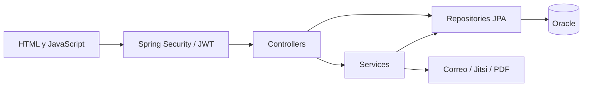

# Tutorías online

**CS // SOFTWARE LAB — 01 / Aplicación académica**

Aplicación para organizar la interacción entre estudiantes y docentes: consultas, intercambio en foros y seguimiento mediante informes. El repositorio conserva el nombre original **Curso-sincronico**.

## Alcance implementado

- Registro, verificación por correo y acceso con JWT.
- Roles de estudiante, docente y administrador; reglas en Spring Security.
- Consultas, respuestas y programación de llamadas.
- Hilos y respuestas de foro, adjuntos e informes PDF.
- Integración Jitsi/JaaS para llamadas y servicio de correo.

Estas capacidades se identificaron por lectura del código. No se afirma disponibilidad de los proveedores externos ni funcionamiento productivo.

## Tecnologías y arquitectura

Java **17**, Spring Boot **3.5.6**, Spring Security, Spring Data JPA, Oracle JDBC, Maven, HTML, CSS y JavaScript. OpenPDF genera informes; las dependencias JWT están declaradas en [pom.xml](./pom.xml).



La organización es por capas; algunos controladores acceden directamente a repositorios. No se presenta como una implementación uniforme de Controller–Service–Repository ni como microservicios.

## Estructura

| Ruta | Responsabilidad |
| --- | --- |
| [config](./src/main/java/com/gestion/emprendedora/config) | Seguridad y JWT. |
| [controllers](./src/main/java/com/gestion/emprendedora/controllers) | Endpoints HTTP. |
| [services](./src/main/java/com/gestion/emprendedora/services) | Operaciones del dominio e integraciones. |
| [repositories](./src/main/java/com/gestion/emprendedora/repositories) | Acceso a datos. |
| [entities](./src/main/java/com/gestion/emprendedora/entities) | Modelo persistente. |
| [static](./src/main/resources/static) | Páginas de la interfaz. |
| [src/test](./src/test) | Pruebas existentes. |

## Preparar el entorno

1. Instalá JDK 17 y cloná este repositorio.
2. Disponé de una instancia Oracle de desarrollo y un usuario propio con permisos para el esquema del proyecto.
3. Revisá las propiedades de conexión, puerto y JPA en tu entorno local. Usá credenciales propias mediante variables de entorno, sin publicarlas.
4. Configurá SMTP y las propiedades requeridas por las clases de correo y JaaS con cuentas de prueba propias. La integración de videollamadas necesita revisar también el recurso de clave que carga el servicio; no alcanza con definir la conexión de base de datos.
5. Verificá un directorio local de adjuntos escribible.

Comandos desde la raíz, después de configurar el entorno:

```powershell
java -version
.\mvnw.cmd spring-boot:run
```

En Linux/macOS: `sh mvnw spring-boot:run`. Para compilar: `.\mvnw.cmd clean package`. Las pruebas de contexto pueden necesitar la base de datos y configuración externa. Estos comandos no se ejecutaron en la revisión de presentación.

## Recorrido de uso

Con la aplicación iniciada, abrí `/pagina_principal.html` en el host y puerto configurados. Registrá una cuenta de prueba y verificá el correo antes del acceso. El panel disponible depende del rol asignado. Probá consultas y foros con datos ficticios; no uses información institucional.

| Endpoint | Uso observado |
| --- | --- |
| POST /api/auth/registrar | Registro. |
| POST /api/auth/login | Acceso. |
| GET /api/foro/hilos | Consulta de hilos. |
| POST /api/foro/hilos | Crear hilo, sujeto al acceso configurado. |
| GET /api/informes/{informeId}/download | Descargar informe. |

La fuente de verdad para payloads y permisos es cada controlador y SecurityConfig.

## Estado y próximos pasos

Proyecto académico con integraciones que requieren configuración. No se publicó una demo ni se generaron capturas con datos de usuarios. Antes de un despliegue real, revisar credenciales y recursos de firma, aislar configuración local, ampliar pruebas de permisos y documentar los contratos de API. Como mejora de arquitectura, uniformar el acceso mediante servicios.

---

[CS // Software Lab · Cristhian Storm](https://github.com/CristhianStorm)

